# Analisis Data Penjualan E-Commerce Tokopaedi | SQL (BigQuery)

## Gambaran Proyek

Proyek ini berisi latihan analisis data penjualan dari **Tokopaedi** (data dummy e-commerce). Di sini saya mencoba mengolah data transaksi dari beberapa channel (Website, Aplikasi, dan Offline Store) untuk melihat tren penjualan dan perilaku pembeli di tahun 2024.

Ada 5 pertanyaan utama yang dijawab di proyek ini:
+ **Laporan Penjualan Bulanan:** Melihat total pendapatan per bulan selama tahun 2024.
+ **Tren Kategori Produk:** Menghitung jumlah barang yang terjual per kategori dari tahun 2020 sampai 2024 untuk bantu cek stok gudang.
+ **Performa Channel Penjualan:** Membandingkan jumlah order dan pendapatan di tiap channel pada tahun 2024, serta kenaikannya dibanding tahun 2023.
+ **Konversi Trafik Organik:** Menghitung berapa persen kunjungan organik yang berhasil jadi transaksi di masing-masing channel.
+ **Pelanggan Baru:** Melihat jumlah pendaftar baru tiap bulan dan rata-rata berapa hari sampai mereka belanja untuk pertama kalinya.

Tools yang dipakai: **Google BigQuery (SQL)** untuk olah data, serta **Python** dan **Google Looker Studio** untuk membuat grafik.  
File query SQL: [Tokopaedi_Analysis_SQL_Code.sql](sql/Tokopaedi_Analysis_SQL_Code.sql)  
File presentasi: [FINPRO SQL.pdf](pdf/FINPRO%20SQL.pdf)

## **Daftar Isi**  
- [Data yang Digunakan](#data-yang-digunakan)  
- [Hasil Analisis](#hasil-analisis)
- [Kesimpulan Singkat](#kesimpulan-singkat)
- [Saran](#saran)

## Data yang Digunakan

Data yang dipakai terdiri dari 6 tabel:
1. **`order_detail`**: Data detail pesanan seperti tanggal order, jumlah barang, harga, dan diskon.
2. **`product_detail`**: Data informasi produk dan kategorinya.
3. **`customer_detail`**: Data pelanggan dan tanggal mereka daftar.
4. **`transaction_detail`**: Data rincian pembayaran (total bayar setelah pajak dan ongkir).
5. **`payment_detail`**: Daftar metode pembayaran.
6. **`funnel_detail`**: Data riwayat kunjungan user di aplikasi atau website.

Skema hubungan antar tabelnya seperti ini:

<a href="images/Scheme.jpg">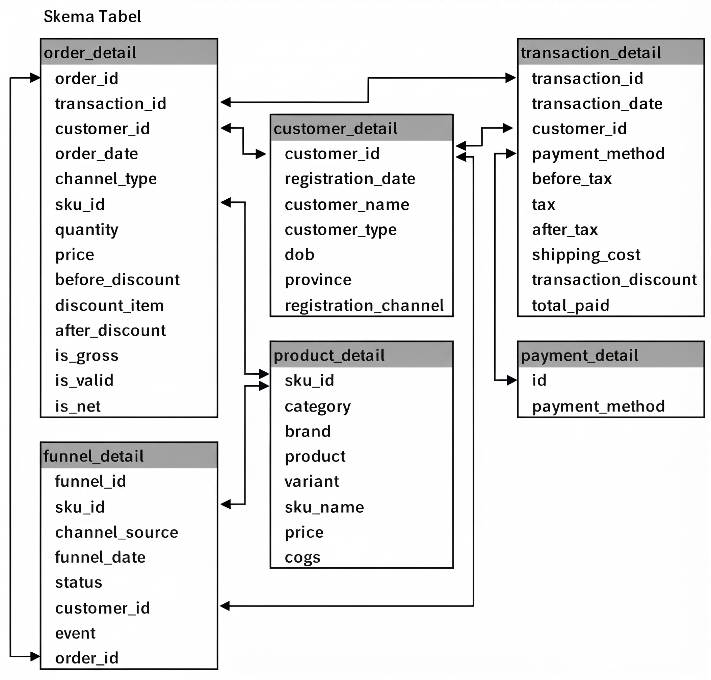</a>

Beberapa kolom penting yang sering dipakai di query:
+ **`total_paid`**: Total uang yang dibayar pembeli (sudah termasuk pajak, ongkir, dan potongan diskon).
+ **`after_discount`**: Harga produk setelah dikurangi diskon.
+ **`is_valid`**: Penanda apakah pesanan sudah dibayar (`1` = sudah bayar).
+ **`event` & `channel_source`**: Asal kunjungan user (misalnya dari pencarian `Organic`) di Website, App Store, atau Play Store.

## Hasil Analisis

### 1. Laporan Pendapatan Bulanan 2024
Pertama, saya menghitung total pendapatan per bulan selama tahun 2024 dari kolom `total_paid` di tabel `transaction_detail`.

<table>
  <tr>
    <td align="left" valign="top">
      <a href="images/revenue-table-2024.jpg">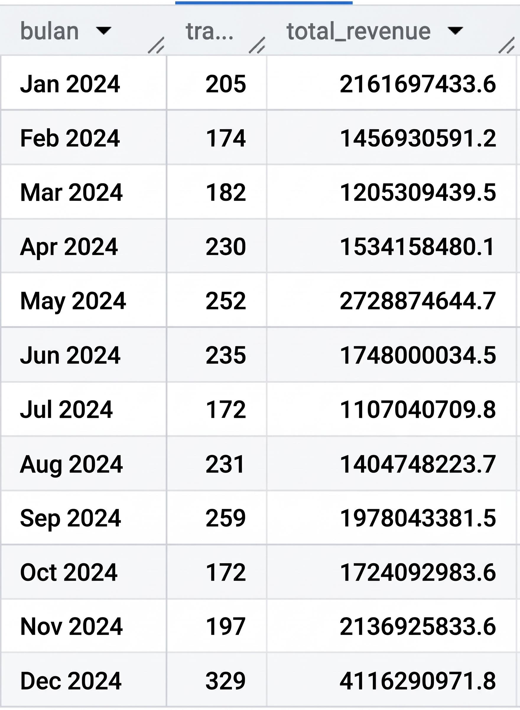</a>
    </td>
    <td align="right" valign="top">
      <a href="images/grafik-table-2024.jpg">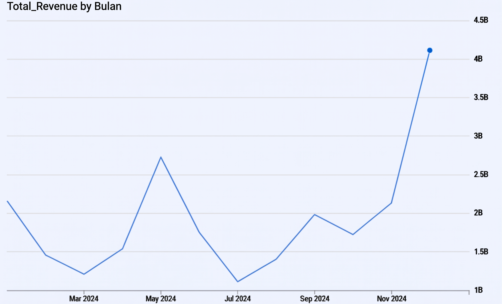</a>
    </td>
  </tr>
</table>

Dari grafik terlihat penjualan tahun 2024 cukup naik turun. Di pertengahan tahun pertama sempat naik tinggi di bulan Mei (Rp2,72 miliar), tapi turun paling rendah di bulan Juli (Rp1,10 miliar).  
Mulai bulan Oktober sampai Desember penjualan naik lagi, dan puncaknya ada di bulan **Desember** yang mencapai **Rp4,11 miliar** (329 transaksi).

---

### 2. Tren Penjualan per Kategori 2020–2024
Untuk melihat barang apa saja yang laku, saya menggabungkan tabel `order_detail` dan `product_detail` lalu menjumlahkan barang yang terjual (`is_valid = 1`) dari tahun 2020 sampai 2024.

<table>
  <tr>
    <td align="left" valign="top">
      <a href="images/table-category-quantity.jpg">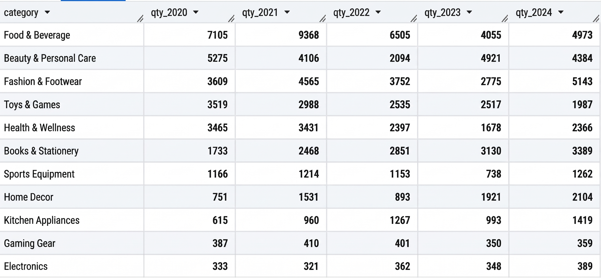</a>
    </td>
    <td align="right" valign="top">
      <a href="images/grafik-category-quantity.jpg">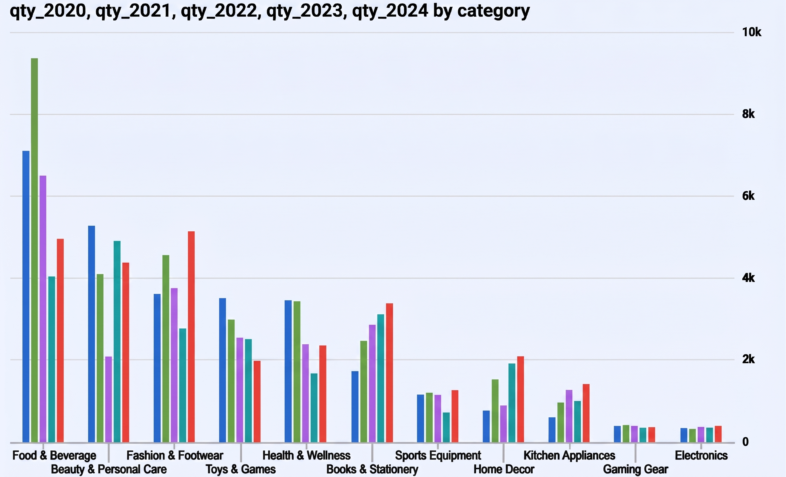</a>
    </td>
  </tr>
</table>

Hasil yang didapat:
+ Penjualan paling ramai sebenarnya sempat terjadi di tahun 2021, terutama untuk kategori *Food & Beverage* (9.368 unit).
+ Di tahun 2024, ada 4 kategori yang penjualannya naik tinggi dan mencetak rekor baru, yaitu **Fashion & Footwear** (5.143 unit), **Books & Stationery** (3.389 unit), **Home Decor** (2.104 unit), dan **Kitchen Appliances** (1.419 unit).
+ Sebaliknya, kategori **Toys & Games** terus turun tiap tahun, dari 3.519 unit di 2020 menjadi 1.987 unit di 2024.

---

### 3. Performa Channel Penjualan 2024 vs 2023
Di bagian ini saya mengecek jumlah pesanan (`COUNT(DISTINCT order_id)`) dan pendapatan (`SUM(after_discount)`) dari *Website*, *App Store*, dan *Offline Store* di tahun 2024, lalu membandingkan total pendapatannya per bulan dengan tahun 2023.

<table>
  <tr>
    <td align="left" valign="top">
      <a href="images/revenue-by-channel-2024.png">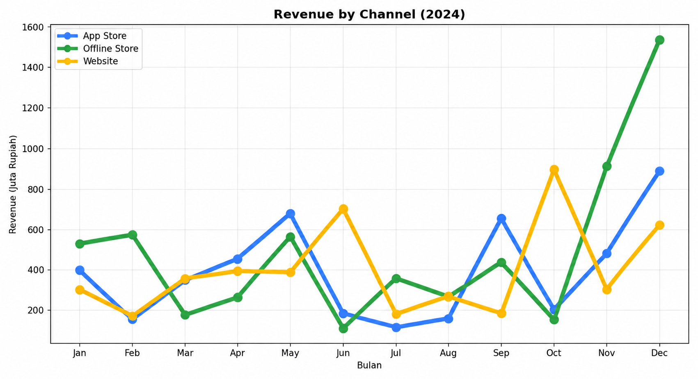</a>
    </td>
    <td align="right" valign="top">
      <a href="images/monthonmonth.jpg">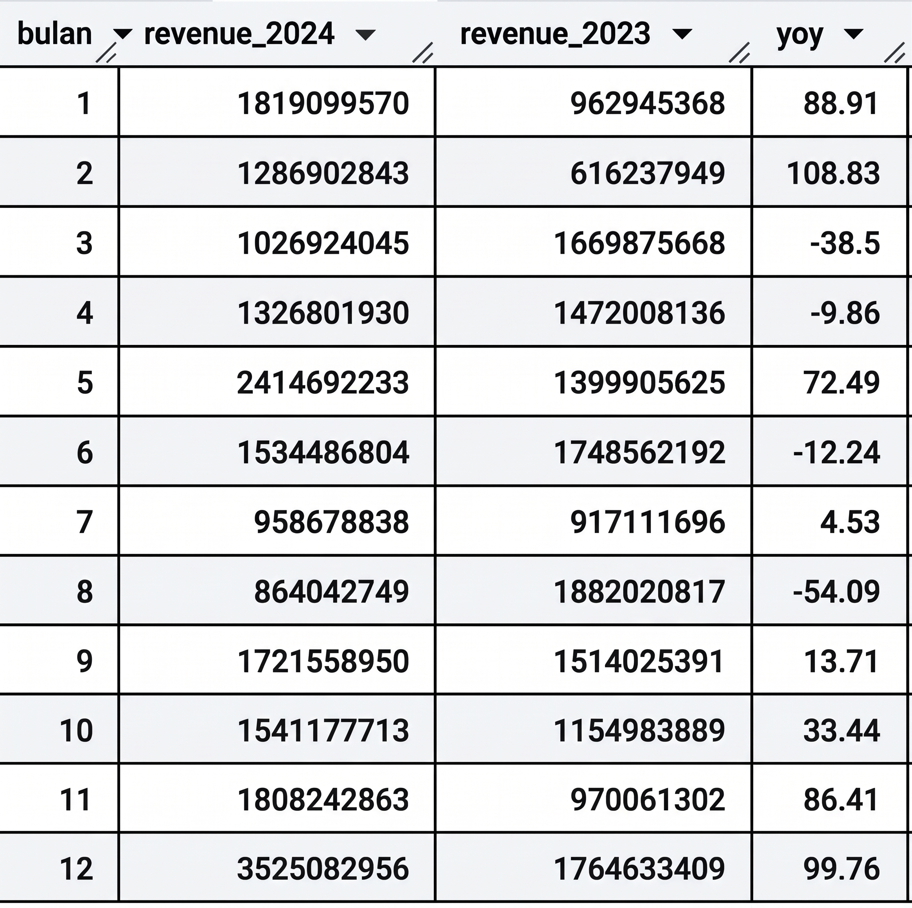</a>
    </td>
  </tr>
</table>

+ **Perbandingan Channel (2024):** **Offline Store** punya jumlah order paling sedikit (1.037 order), tapi pendapatannya paling besar (**Rp5,9 miliar**). Ini kemungkinan karena orang yang belanja langsung di toko membeli barang dengan harga lebih mahal atau jumlah lebih banyak sekaligus, terutama di bulan November dan Desember. Sementara itu, **Website** paling sering dipakai belanja (1.182 order) tapi total pendapatannya Rp4,78 miliar.
+ **Perbandingan 2024 vs 2023:** Kalau dibandingkan bulan yang sama di 2023, pendapatan tahun 2024 naik cukup tinggi di bulan Februari (+108,83%), Desember (+99,76%), Januari (+88,91%), dan November (+86,41%). Tapi sempat minus di bulan Agustus (-54,09%) dan Maret (-38,50%).

---

### 4. Konversi Trafik Organik 2024
Bagian ini melihat seberapa banyak kunjungan organik (`event = 'Organic'`) yang akhirnya beneran checkout menjadi pesanan di masing-masing channel.

<table>
  <tr>
    <td align="left" valign="top">
      <a href="images/channel-trafic.png">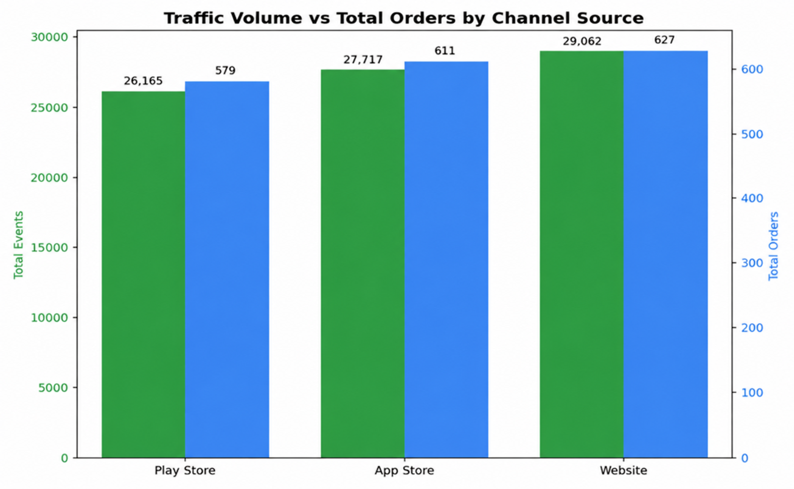</a>
    </td>
    <td align="right" valign="top">
      <a href="images/acquisition.png">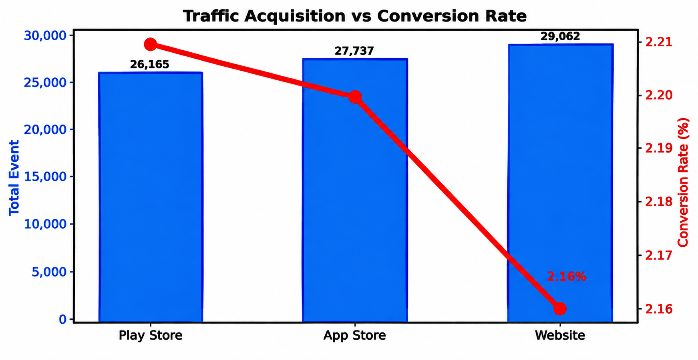</a>
    </td>
  </tr>
</table>

+ **Kunjungan vs Persentase Belanja:** Kunjungan organik paling banyak ada di **Website** (**29.062 kunjungan**, 627 order), lalu **App Store** (**27.717 kunjungan**, 611 order), dan **Play Store** (**26.165 kunjungan**, 579 order).
+ Walaupun pengunjungnya paling sedikit, persentase konversi di **Play Store** sedikit lebih tinggi (**2,21%**), disusul **App Store** (**2,20%**), dan **Website** (**2,16%**).

---

### 5. Pelanggan Baru & Waktu Pertama Kali Belanja 2024
Terakhir, saya menghitung jumlah pengguna yang baru daftar di tahun 2024, lalu mengecek berapa orang yang sudah pernah belanja (`is_valid = 1`) dan rata-rata selisih hari dari tanggal daftar sampai tanggal belanja pertama.

<table>
  <tr>
    <td align="left" valign="top">
      <a href="images/new-customers.jpg">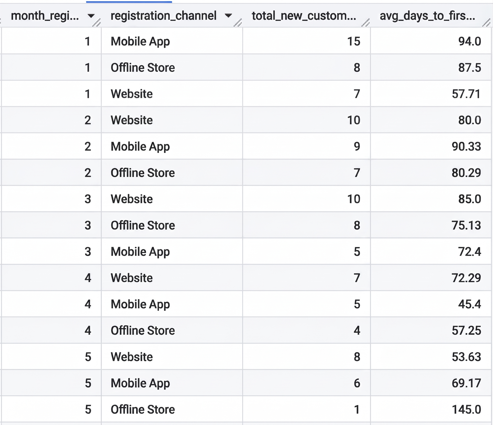</a>
    </td>
    <td align="right" valign="top">
      <a href="images/new-customers.png">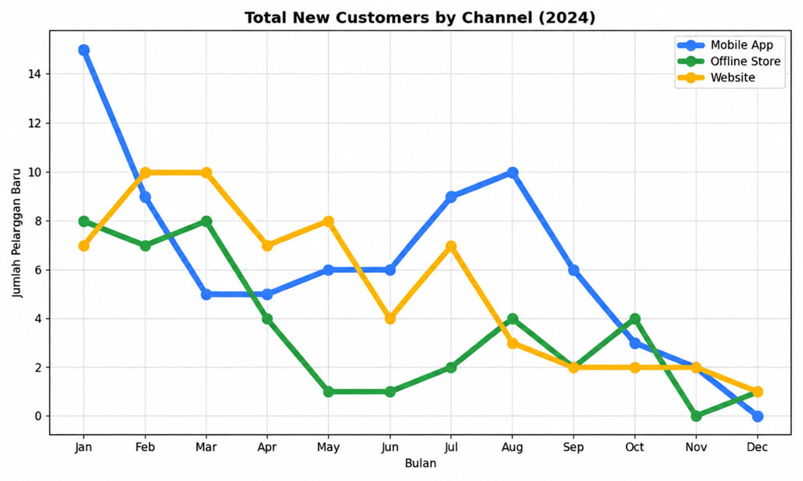</a>
    </td>
  </tr>
</table>

+ **Tren Pendaftar Baru:** Jumlah pendaftar baru di *Mobile App*, *Website*, maupun *Offline Store* cenderung menurun dari awal tahun ke akhir tahun 2024. Paling banyak ada di bulan Januari lewat *Mobile App* (15 pelanggan baru).
+ **Jeda Waktu Belanja Pertama:** Ternyata tidak semua yang daftar langsung belanja. Untuk pelanggan yang sudah transaksi, rata-rata mereka baru melakukan pembelian pertama sekitar **45 sampai 145 hari** setelah daftar.

## Kesimpulan Singkat

+ **Penjualan Akhir Tahun Tinggi:** Pendapatan terbesar terjadi di akhir tahun, khususnya bulan Desember (Rp4,11 miliar), sedangkan bulan Juli paling sepi (Rp1,10 miliar).
+ **Kategori yang Lagi Naik:** *Fashion & Footwear*, *Books & Stationery*, *Home Decor*, dan *Kitchen Appliances* laku keras di 2024, sementara *Toys & Games* terus menurun.
+ **Perbedaan Tiap Channel:** *Offline Store* menghasilkan uang paling banyak (Rp5,9 miliar), sedangkan *Website* punya jumlah transaksi paling sering (1.182 order).
+ **Konversi Aplikasi Sedikit Lebih Unggul:** Persentase pengunjung organik yang jadi belanja di *Play Store* (2,21%) dan *App Store* (2,20%) sedikit lebih tinggi daripada *Website* (2,16%).
+ **User Baru Lama Checkout:** Rata-rata pengguna baru butuh waktu lebih dari 45 hari sejak daftar sampai akhirnya belanja pertama kali.

## Saran

Berdasarkan hasil di atas, beberapa hal sederhana yang bisa dilakukan:

+ **Stok Gudang:** Perbanyak stok untuk kategori yang sedang naik (*Fashion & Footwear*, *Home Decor*, *Books & Stationery*, dan *Kitchen Appliances*) terutama menjelang akhir tahun, dan kurangi stok *Toys & Games* karena peminatnya turun terus.
+ **Promo Pertengahan Tahun & Website:** Buat promo di bulan Juli–Agustus supaya penjualan tidak terlalu anjlok. Di *Website*, bisa dibuat promo paket (*bundling*) atau minimal belanja supaya nilai per transaksinya ikut naik seperti di *Offline Store*.
+ **Perbaikan Website:** Cek lagi tampilan atau proses pembayaran di *Website* supaya pengunjung organik yang jumlahnya banyak itu lebih mudah checkout.
+ **Voucher Pengguna Baru:** Berikan voucher diskon khusus pengguna baru dengan batas waktu singkat (misal berlaku 7 hari setelah daftar) supaya mereka langsung belanja dan tidak menunggu berbulan-bulan.
